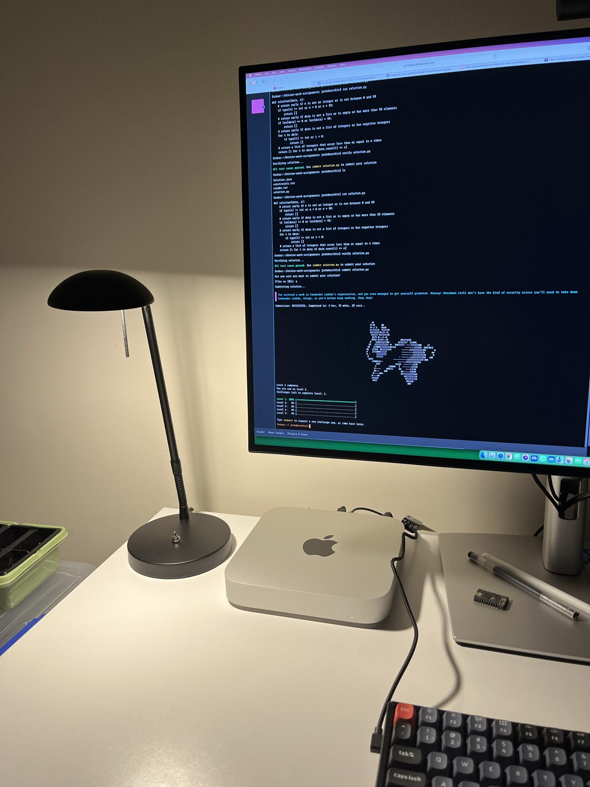
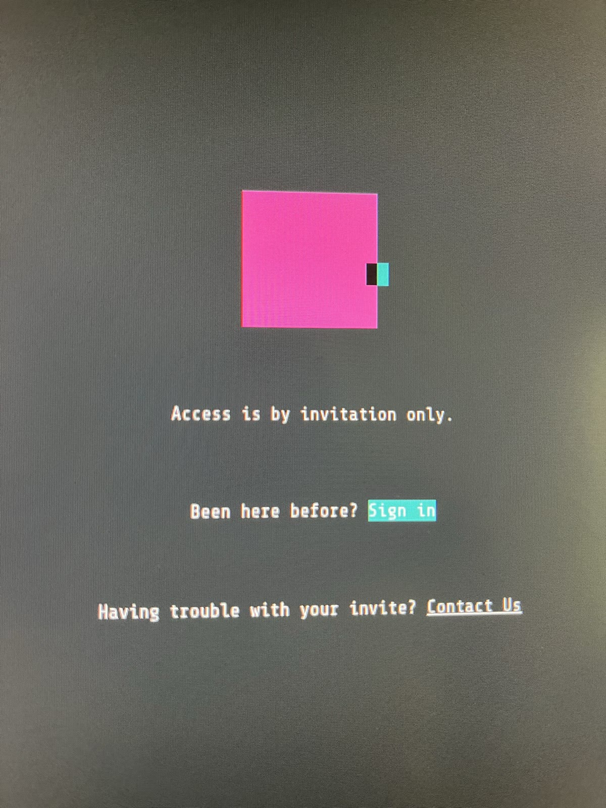
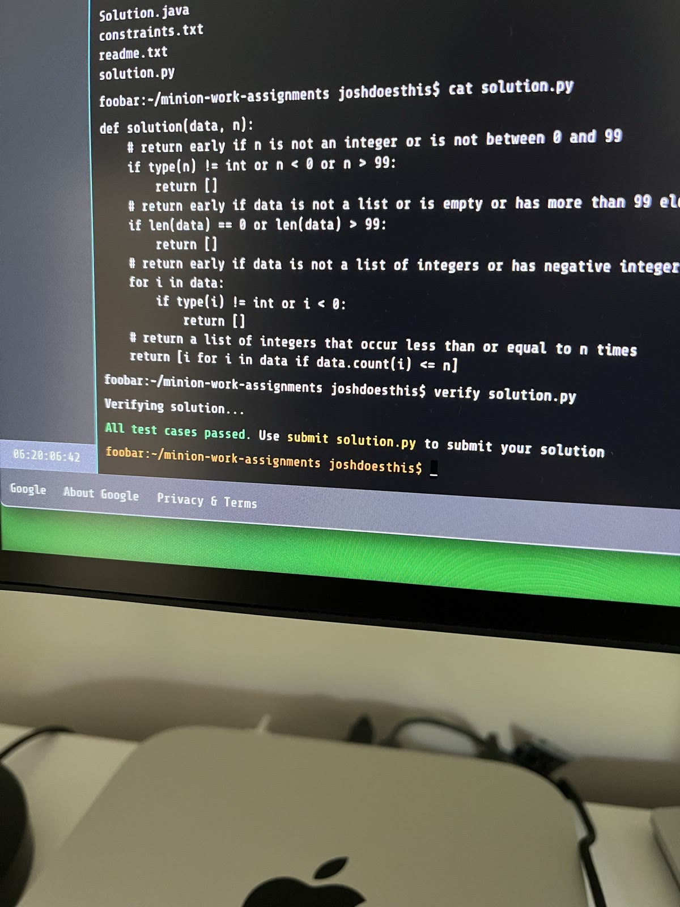
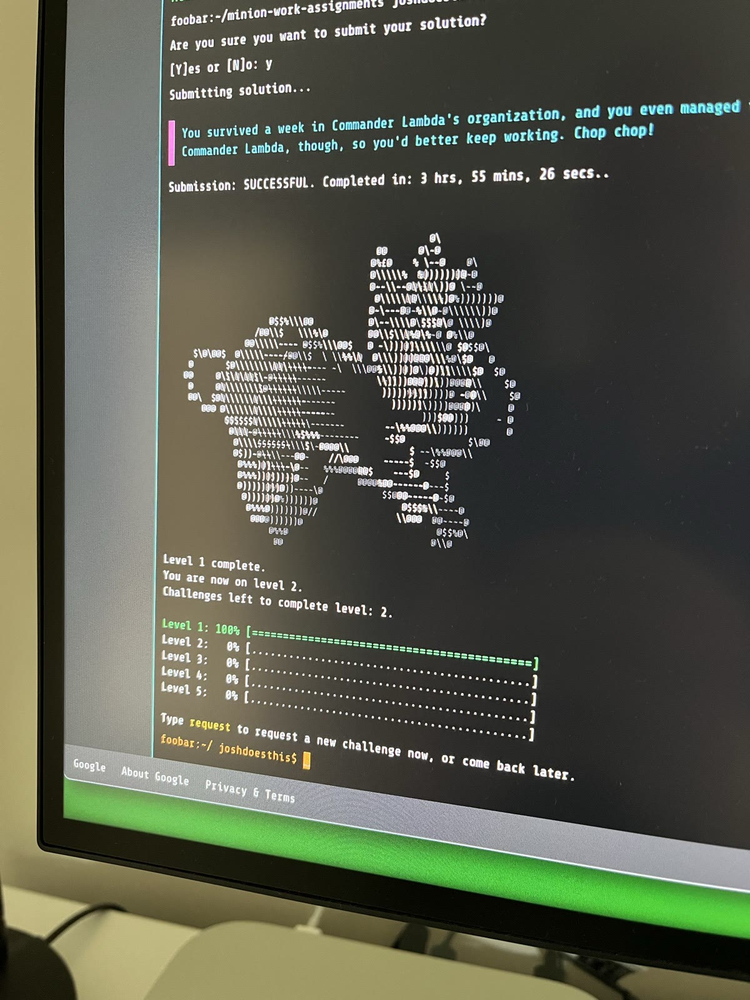
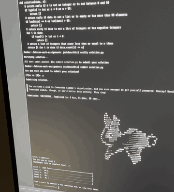
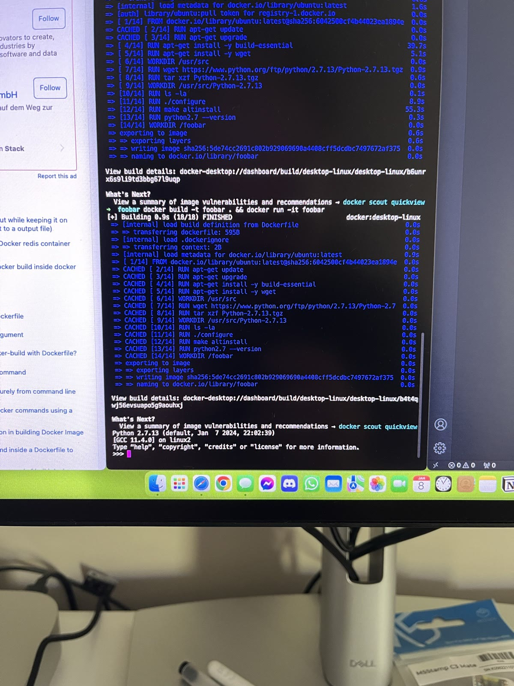

# Google Foobar

My solutions and notes from **Google Foobar**, Google's invite-only hiring challenge, which has since been shut down.

<p align="center">
  
</p>

## What Foobar was

Foobar was an easter egg hidden in Google Search. Searching certain programming terms could make the page fold open with an invitation, which led to a terminal in the browser. From there you worked through timed coding challenges in a sandboxed Python 2.7 or Java 8 environment.

The challenges came wrapped in a story. You were an undercover agent on Commander Lambda's space station, trying to stop the LAMBCHOP doomsday device and free the bunnies. Each level you cleared earned a promotion and a little more of the plot.

## My run (January 2024)

My invitation came from a search for something like "what is a bloom filter". Instead of the usual results, the page showed a message for curious developers, with buttons to accept the invitation.

I solved three challenges over three days and reached level 3. The first one, Minion Work Assignments, took me 3 hours, 55 minutes and 26 seconds from start to submission.

<p align="center">
  
  
  
</p>
<p align="center"><sub>The invitation screen · all test cases passed · level 1 complete</sub></p>

| Level | Challenge | Problem | Approach |
|---|---|---|---|
| 1 | [Minion Work Assignments](level-1/) | Remove every number that appears more than `n` times, keeping the original order | Validate the inputs, then keep only values whose count is at most `n` |
| 2 | [Numbers Station Coded Messages](level-2/challenge-1/) | Find the first contiguous sub-list that sums to a target key | Check each start index, extend the window while the sum stays at or under the target, and stop early once it goes over |
| 2 | [Don't Get Volunteered!](level-2/challenge-2/) | Find the fewest knight moves between two squares on a chessboard | Breadth-first search, expanding all reachable squares one move at a time |
| 3 | [Challenge 1](level-3/challenge-1/) | — | Reached, but never completed (see below) |

Each challenge folder keeps the original prompt (`README.md`), the sandbox rules (`constraints.md`) and my solution (`solution.py`).

Finishing a level played an ASCII-art bunny animation in the terminal:

<p align="center">
  
</p>

## Where it ended

I wanted to keep going and work my way through the higher levels, but Google shut Foobar down in 2024, before I got the chance. The empty `level-3` folder is where the next challenge would have gone.

## The story

[journal.md](journal.md) collects the story messages that appeared as I moved up the ranks, from entry-level Minion to Commander Lambda's personal assistant.

## Running the solutions

The solutions also run on modern Python 3:

```sh
python3 -c "import sys; sys.path.insert(0, 'level-2/challenge-2'); from solution import solution; print(solution(0, 1))"
```

To match the original sandbox, I built a Docker image that compiles Python 2.7.13 from source:

```sh
docker compose up -d
docker compose exec foobar python2.7 -c "import sys; sys.path.insert(0, 'level-1'); from solution import solution; print(solution([1, 2, 2, 3, 3, 3, 4, 5, 5], 1))"
```

<p align="center">
  
</p>
